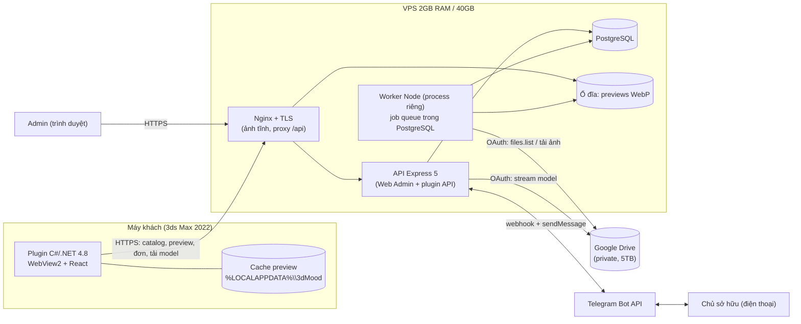
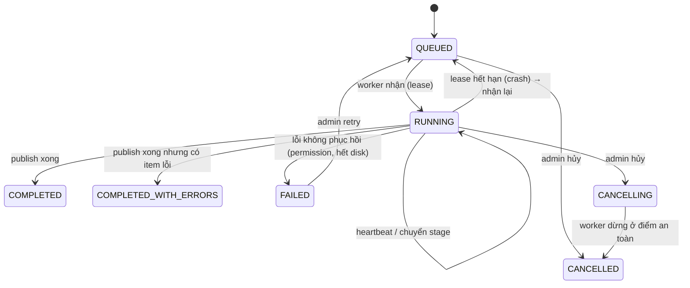

# 3DS Mood v3 — Kiến trúc thống nhất (Phase 0: audit + thiết kế)

> **2026-10-30:** D26 thay phần Drive private/OAuth và stream trực tiếp từ Drive. Xem mục "Bàn giao" trong `v3-implementation-plan.md`.

> Viết 2026-10-29 · nhánh `phuc_arch_v3` (dựng từ `origin/nam-lisence` @ `ba41518`) · **Chưa có dòng code nào được sửa, chưa chạy migration.**
> Đi kèm: [`v3-database.md`](v3-database.md) (ERD + migration) · [`v3-implementation-plan.md`](v3-implementation-plan.md) (plan từng phase + API contract).
> Nguồn yêu cầu: master prompt của chủ dự án + mô tả luồng kinh doanh (mục 0.1). Nhãn dùng trong tài liệu:
> **[ĐÃ XÁC MINH]** = đọc từ source/git · **[GIẢ ĐỊNH]** = suy luận, cần xác nhận · **[CHƯA KIỂM CHỨNG]** = cần thử thật.

---

## 0. Tóm tắt và những điều cần chủ dự án duyệt

### 0.1 Luồng kinh doanh đích (theo chủ dự án)

```text
Khách duyệt thư viện trong plugin  ──►  chọn model  ──►  thanh toán chuyển khoản (quét mã QR)
        ──►  bot Telegram nhắn chủ sở hữu  ──►  chủ bấm "Đã nhận tiền"
        ──►  hệ thống nhả license cho model đó  ──►  plugin Download  ──►  import vào 3ds Max
Admin chỉ cần thả model + ảnh vào Google Drive  ──►  bấm "Quét đồng bộ"  ──►  mọi plugin tự thấy model mới
```

### 0.2 Quyết định đã chốt (chủ dự án trả lời 2026-10-29)

| # | Câu hỏi | **Đã chốt** | Hệ quả thiết kế |
|---|---|---|---|
| Q1 | Bán theo model hay toàn thư viện? | **Bán theo từng model, license vĩnh viễn** cho model đó | `entitlements.scope='MODEL'` là loại bán duy nhất. `ALL_MODELS` **chỉ** dùng cho khách cũ có license MXL1 và cho admin cấp tay |
| Q2 | Push tới plugin? | **Không push; plugin phải tự biết và tự cập nhật** khi chủ thêm model | Plugin tự kiểm `catalog/version` khi mở, **mỗi 5 phút** khi đang mở, và qua SSE nếu kết nối được → tự tải catalog + preview mới **không cần người dùng bấm gì** (mục 3.2) |
| Q3 | Danh tính khách | **Thiết bị, không tài khoản** | Như thiết kế |
| Q4 | OAuth Gmail B / Service Account | **OAuth Gmail B; P1 thử thật và đánh giá Service Account** | Như thiết kế |
| Q5 | Module đơn + Telegram | **Xác nhận thêm** | Team F |
| Q6 | Thông tin tài khoản nhận tiền | **Sửa được trong trang admin**, nhập sau | Bảng `app_settings` + màn Cài đặt; mỗi đơn **chụp lại** thông tin ngân hàng lúc tạo |
| Q7 | Preview trên máy khách | **Tải plugin là có luôn ảnh preview trên máy**; file zip/rar nằm trên Drive, thông tin nằm trên VPS | Bộ cài **mang sẵn bộ preview** (sinh từ manifest VPS lúc build), lần mở đầu chép vào cache rồi chỉ đồng bộ phần chênh lệch (mục 3.2) |
| Q8 | Giao diện v3 | **Dùng lại giao diện tối UI-1** (commit `13ad8f4`, nhánh `hung-connection_to_3dsmax`) | Không dùng giao diện sáng của `phuc_apps` hay `OfflineLibrary` của nhánh nam |

### 0.3 Điều kiện bắt đầu code

P0 **đã xong** (mục 0.2). Còn mở nhưng **không chặn** code: thông tin ngân hàng (nhập ở admin), Q4 (chốt cuối P1). API contract trong `v3-implementation-plan.md` §2 coi là **frozen v1**. Mọi thay đổi phá vỡ contract phải sửa tài liệu trước khi merge.

---

## 1. Current Architecture Audit

### 1.1 Repo hiện có (nhánh `nam-lisence`, 590 file đổi so với nhánh Hùng)

```text
apps/store-api/      Express 5 + pg. License theo tài khoản, payOS, R2, Drive-cũ, admin tài khoản (migration 001–013)
apps/store-web/      React 19 + Vite 7 + Tailwind 4. Theme tối (UI-1). main.jsx CHỈ mount <OfflineLibrary/>
apps/license-admin/  Trang admin Vercel: đăng nhập bằng 1 mật khẩu, ký license MXL1 (RSA), KHÔNG có database
library/public/      catalog.json (360 mục) + 362 ảnh preview đóng gói trong plugin
plugin-csharp/       C# net48: license offline, DeviceIdentityService (CNG/TPM), GoogleDriveDownloader, ArchivePackage, import
tools/               license-owner (CLI ký license), catalog-import (nhập từ Drive bằng API key)
cloudflare/          r2-consumer — KHÔNG dùng (cấm theo prompt)
```

### 1.2 Hai hệ license **đang cùng tồn tại và không nói chuyện với nhau** [ĐÃ XÁC MINH]

| | Hệ A — license offline **(plugin khách đang dùng)** | Hệ B — license trong PostgreSQL **(D11/D12)** |
|---|---|---|
| Định dạng | Token `MXL1.<payload>.<chữ ký RSA>`, ký bởi `apps/license-admin` (Vercel) | Bảng `licenses` + `license_devices` (migration 003) |
| Gắn với | **Mã máy** `MAX-<SHA256 của MachineGuid>` | **Tài khoản** `users.id` (`unique`), tối đa 2 thiết bị |
| Xác minh | Plugin xác minh offline bằng public key, không cần mạng | Server, qua challenge ký bằng khóa CNG của máy |
| Server biết không? | **Không.** Vercel ký xong là hết, không lưu | Có |
| Thu hồi | **Không thể** (offline vĩnh viễn) | Có (SUSPENDED/REVOKED) |

**Hệ quả:** backend mới **không thể** kiểm tra "license còn hiệu lực" theo yêu cầu nếu chỉ dùng Hệ A, vì server không lưu gì. Đây là khoảng trống kiến trúc lớn nhất và là lý do có Q1/Q3.

### 1.3 Plugin hiện tại

| Hạng mục | Hiện trạng | Giữ / đổi |
|---|---|---|
| UI | `main.jsx` chỉ mount `OfflineLibrary`. Bộ UI online (`App.jsx`, `LicensePanel`, `PaymentDialog`, admin…) vẫn trong repo nhưng **không được mount** | Dùng lại thành phần UI-1; mount chế độ online |
| Catalog + preview | Đọc `library/catalog.json` + ảnh từ thư mục cài, phục vụ qua origin ảo `app.3dsmood.local` (`StaticCatalogService`) | **Đổi**: lấy từ API + cache local |
| Tải model | `GoogleDriveDownloader.cs` tải thẳng `drive.google.com/uc?export=download` (link công khai), kiểm SHA-256 | **Thay** bằng tải từ backend VPS; **bỏ** allowlist `drive.google.com` |
| Giải nén + import | `ArchivePackage.cs`, `ImportTargetSelection.cs`, `PlatformBridge.ms` (merge) | **Giữ nguyên** |
| Danh tính thiết bị | `DeviceIdentityService.cs`: UUID (DPAPI) + khóa RSA CNG không export, ưu tiên TPM | **Giữ + tái dùng** làm danh tính thiết bị (Q3) |
| Bridge | `BridgePolicy.cs` allowlist method + kiểm schema | Giữ; thêm method theo mục 2.4 |
| Cache preview | Không có (đã đóng gói sẵn trong bộ cài) | **Mới**: `%LOCALAPPDATA%\3dMood\Previews\` |
| Chế độ online | `PackagedAppRuntime` vẫn có nhánh `!IsOfflineLibrary` (proxy `/api/*`, `SessionCookieStore`) | Tái dùng nhánh này làm nền |

### 1.4 Backend hiện tại

| Module | Trạng thái | Quyết định |
|---|---|---|
| `db.js` + `migrate.js` + `migrations/*.sql` + `rollback/` | Chạy được, có advisory lock | **Giữ** (thêm migration 014+) |
| `download-stream.js` (`createArchiveSender`) | Streaming, giới hạn đồng thời (mặc định 4), timeout 30', abort khi client ngắt, kiểm kích thước. Nhận một `provider.openDownload()` | **Tái dùng** — chỉ cần viết `DriveProvider` |
| `licensing/device-crypto.js` + `/device/challenge|verify` | Challenge một lần, TTL 2 phút, kiểm chữ ký RSA | **Tái dùng**, đổi danh tính từ "tài khoản+license" sang "thiết bị" |
| `admin/*` + `users.role` (011) | Admin theo tài khoản DB, đổi mật khẩu, audit | **Giữ làm Web Admin duy nhất** (Q: bỏ `apps/license-admin` Vercel, xem 1.5) |
| `auth*.js` (JWT cookie khách) | Đăng nhập khách | **Gỡ khỏi luồng khách** (Q3); giữ cho admin |
| `payments/` (payOS) | Đầy đủ | **Tắt/bỏ** (cấm triển khai lại) |
| `r2/`, `cloudflare/` | Đầy đủ | **Xóa** (cấm dùng R2) |
| Catalog tables 008–010 (`catalog_*`) | Bảng catalog cũ cho Drive-cũ/R2 | **Thay** bằng bảng mới (database doc) |
| Drive client | **Không có** trong store-api (chỉ `tools/catalog-import` dùng API key + link công khai) | **Mới** hoàn toàn: OAuth, scanner, worker |
| Telegram / OAuth Google | `grep` toàn repo: **không có** | Mới |

### 1.5 Admin: hai hệ cũng chồng nhau

`apps/license-admin` (Vercel, 1 mật khẩu dùng chung, không DB) **và** admin trong `store-api` (tài khoản DB, audit). Prompt yêu cầu "tận dụng admin hiện có, không tạo Web Admin riêng". **Đề xuất:** dùng admin của `store-api` + `store-web` làm duy nhất; đưa việc ký license vào đó (ghi DB + audit); giữ `tools/license-owner` làm công cụ khẩn cấp offline. Vercel admin ngừng dùng sau khi chuyển.

### 1.6 Dữ liệu thực tế

| Hạng mục | Giá trị | Nhãn |
|---|---|---|
| Số model trong catalog đóng gói | 360 (313 `.rar`, 45 `.zip`, 2 `.7z`) | ĐÃ XÁC MINH |
| Cấu trúc Drive | `root 3DSMOOD / 126 folder / 845 file / 360 model` (báo cáo của nhánh nam) | ĐÃ XÁC MINH (theo tài liệu tác giả; chưa tự chạy) |
| Bố cục thư mục | **Phẳng theo cặp**: `<Category>/<Sub>/<tên>.jpg` + `<tên>.rar` (đã thấy trên bản local `source/3DSMOOD`) — **không phải** thư mục riêng cho từng model như ví dụ trong prompt | ĐÃ XÁC MINH trên local; Drive [GIẢ ĐỊNH] giống |
| Dung lượng preview | **48,5 MB / 362 file (~137 KB/ảnh)** trong `library/public/previews` | ĐÃ XÁC MINH |
| "Preview ~10GB" (prompt) | **Không khớp.** 10 GB là tổng dung lượng **file nén model** của `source/3DSMOOD` (10,2 GB), không phải preview | Cần chủ dự án xác nhận |
| Model ID hiện tại | Chuỗi tự đặt, hai kiểu lẫn nhau: `036-bbq-bubble-spot` và `drive-42052a8ee13c92bb4def9469` | ĐÃ XÁC MINH |
| `entryFile` | Chỉ 1/360 mục có | ĐÃ XÁC MINH |
| Dung lượng VPS cần cho preview | Rất nhỏ: bản ingest cục bộ của chúng ta cho 360 model ra 720 ảnh WebP = **39 MB** | ĐÃ XÁC MINH |

### 1.7 Khoảng trống so với yêu cầu

1. Không có OAuth/Drive client/worker/job queue (toàn bộ Team B).
2. Backend không biết license offline (mục 1.2).
3. Plugin không có cache preview, không gọi API catalog, không tải model qua backend.
4. Không có luồng đơn hàng + Telegram.
5. Catalog chưa có Model ID ổn định (UUID) và chưa có category dạng cây ở DB.
6. Tài liệu `decisions.md` của nhánh nam có D5–D16 chồng nhau, nhiều mục "đã thay thế" — cần dọn khi chốt D17+.

---

## 2. Final Architecture

### 2.1 Thành phần và ranh giới



### 2.2 Trách nhiệm (không được vượt ranh giới)

| Thành phần | Có trách nhiệm | **Không** |
|---|---|---|
| Plugin | Hiển thị catalog/preview từ cache; xin tạo đơn; giữ khóa thiết bị; tải model **qua backend**; giải nén an toàn; merge trong Max | Không bao giờ nhận Drive ID, URL Drive, OAuth token. Không có tài khoản Google |
| API | Xác thực admin & thiết bị; catalog/manifest; đơn hàng; cấp quyền; **stream model từ Drive**; audit | Không quét Drive (việc của worker); không giữ file model trên đĩa |
| Worker | Quét Drive, so sánh, tải/xử lý preview, publish catalog | Không phục vụ khách; không tải model cho khách |
| PostgreSQL | **Nguồn dữ liệu catalog đã xác thực và công bố**; hàng đợi job; quyền | Không lưu nhị phân ảnh/model |
| Google Drive | Nguồn **file gốc** | Không phải nguồn catalog |
| Nginx | TLS, phục vụ preview tĩnh, giới hạn kết nối/tốc độ | Không chứa logic nghiệp vụ |
| Telegram | Kênh thông báo + xác nhận thu tiền của chủ | Không phải bằng chứng thanh toán tự động (xem 8.4) |

### 2.3 Hai tiến trình Node, một codebase

`store-api` khởi chạy với `node src/server.js` (API) và `node src/worker.js` (worker), **cùng migration, cùng module DB**. Worker không mở cổng HTTP. Hai tiến trình dùng chung 2 GB RAM: ngân sách đề xuất API ≤ 300 MB, worker ≤ 400 MB (Sharp), PostgreSQL ≤ 400 MB, còn lại cho Nginx/OS. [GIẢ ĐỊNH — đo thật ở Phase 5]

### 2.4 Bridge plugin (thay đổi allowlist)

Hiện có: `library.status | library.activate | library.refresh | asset.import | device.*`. Đề xuất:

| Method | Mục đích | Ghi chú |
|---|---|---|
| `library.refresh` | (giữ) trả catalog từ cache + kích hoạt đồng bộ nền | Thêm trường tiến độ |
| `library.previewProgress` (event) | % tải preview nền | Event, không phải RPC |
| `order.create` / `order.status` | Tạo đơn, kiểm trạng thái | Web gọi API qua proxy của host; token thiết bị **chỉ ở native**, JS không thấy |
| `asset.import` | (giữ tên) nhận `{ modelId }` — **không còn `ticket`** | Native tự xin phiên tải |
| `library.activate` | (giữ) nhập license MXL1 cũ | Tương thích ngược |

Không thêm method kiểu `executeScript`, `readFile`, `shell` (CLAUDE.md §C.1).

---

## 3. E2E Sequence Diagrams

### 3.1 Admin quét đồng bộ Drive

```mermaid
sequenceDiagram
  autonumber
  actor A as Admin
  participant UI as Web Admin
  participant API as API
  participant DB as PostgreSQL
  participant W as Worker
  participant GD as Google Drive
  A->>UI: bấm "Quét đồng bộ"
  UI->>API: POST /admin/drive/sync-jobs {sourceId, mode}
  API->>DB: kiểm quyền admin, OAuth còn hiệu lực, root truy cập được, không có job trùng
  API->>DB: INSERT job (status=QUEUED)
  API-->>UI: 202 {jobId}
  UI->>API: GET /sync-jobs/:id/events (SSE)
  W->>DB: claim job (lease + heartbeat)
  loop A. Scanning
    W->>GD: files.list (pageToken)
    W->>DB: ghi drive_inventory (staging)
  end
  W->>DB: B. Comparing → NEW/MODIFIED/UNCHANGED/MISSING/NEEDS_REVIEW
  loop C. Downloading preview (≤2 song song)
    W->>GD: files.get alt=media (chỉ ảnh mới/đổi)
    W->>W: ghi .part → kiểm size/sha256/magic → Sharp → WebP
    W->>W: rename nguyên tử
  end
  W->>DB: D. Publishing (1 transaction): upsert model, preview; catalog_version+1; manifest mới
  W->>DB: E. COMPLETED + số liệu
  API-->>UI: SSE: stage, counters, kết quả
```

### 3.2 Plugin đồng bộ preview (có sẵn khi cài + tự cập nhật)

**Lúc build bộ cài:** script build tải `GET /api/v1/previews/manifest` + toàn bộ ảnh từ VPS → đóng vào bộ cài thư mục `seed/`
(ảnh **đúng tên `<sha256>.webp`** như VPS, nên không phải tải lại). Hiện ~360 model × 2 biến thể ≈ 40–50 MB.
**Lần mở đầu:** chép `seed/` vào `%LOCALAPPDATA%\3dMood\Previews\` (kiểm sha256 từng file) → xem được ngay, kể cả offline.
**Sau đó:** chỉ tải phần chênh lệch. Kích hoạt bởi: mở plugin · mỗi 5 phút khi đang mở · sự kiện SSE `catalog.updated`.

```mermaid
sequenceDiagram
  autonumber
  participant P as Plugin
  participant C as Cache local
  participant N as Nginx/API
  P->>C: lần đầu: chép seed trong bộ cài vào cache (kiểm sha256)
  P->>C: đọc manifest local (hiện ngay, kể cả offline)
  P->>N: GET /api/v1/catalog/version (If-None-Match)
  alt không đổi (304)
    P->>P: dùng cache
  else đổi
    P->>N: GET /api/v1/previews/manifest
    P->>P: so sánh sha256/version theo modelId → danh sách cần tải
    loop ưu tiên category đang mở, rồi phần còn lại ở nền
      P->>N: GET /previews/<hash>.webp
      P->>P: ghi .part → kiểm sha256 → đổi tên → cho UI hiển thị
    end
  end
  Note over P,N: Lặp lại mỗi 5 phút khi plugin đang mở; SSE catalog.updated kích hoạt ngay
```

### 3.3 Mua model và nhả quyền (Telegram) — **module Team F**

```mermaid
sequenceDiagram
  autonumber
  actor K as Khách
  participant P as Plugin
  participant API as API
  participant DB as PostgreSQL
  participant TG as Telegram
  actor O as Chủ sở hữu
  K->>P: bấm "Mua" trên model
  P->>API: POST /api/v1/orders {items:[{modelId}]} (device token)
  API->>DB: tính giá từ DB (không tin client); tạo đơn PENDING_PAYMENT + mã đơn
  API-->>P: {orderId, code, amount, payload QR}
  P-->>K: hiện mã QR + nội dung chuyển khoản = mã đơn
  K->>K: chuyển khoản
  K->>P: bấm "Tôi đã chuyển khoản"
  P->>API: POST /v1/orders/:id/claim-paid
  API->>DB: PENDING_PAYMENT → AWAITING_OWNER (chống bấm trùng)
  API->>TG: sendMessage cho chủ: mã đơn, số tiền, mô tả máy, nút [✅ Đã nhận tiền] [❌ Chưa thấy]
  loop Plugin hỏi mỗi 4s (tối đa vài phút, hiện đếm ngược)
    P->>API: GET /v1/orders/:id
  end
  O->>TG: bấm ✅
  TG->>API: webhook callback_query (kiểm secret token + chat_id của chủ)
  API->>DB: 1 transaction: AWAITING_OWNER → CONFIRMED; INSERT entitlements; audit
  API->>TG: sửa tin nhắn "Đã xác nhận bởi …"
  P->>API: GET /v1/orders/:id → CONFIRMED
  P-->>K: nút Mua → Download
```

### 3.4 Tải model và merge

```mermaid
sequenceDiagram
  autonumber
  participant P as Plugin (native)
  participant API as API
  participant DB as PostgreSQL
  participant GD as Google Drive
  participant M as 3ds Max
  P->>API: POST /v1/device/challenge → ký bằng khóa CNG/TPM → POST /v1/device/verify
  API-->>P: device token ngắn hạn (chỉ giữ ở native)
  P->>API: POST /v1/models/:modelId/import-session
  API->>DB: thiết bị còn hiệu lực? có entitlement (model hoặc ALL_MODELS, chưa thu hồi)? model được phép tải?
  API-->>P: 201 {sessionId, expiresAt, size, sha256}  (không có Drive ID/URL)
  P->>API: GET /v1/model-downloads/:sessionId
  API->>DB: tìm drive_file_id nội bộ; ghi log bắt đầu
  API->>GD: files.get alt=media (OAuth server-side)
  GD-->>API: stream
  API-->>P: stream (backpressure, abort khi ngắt, giới hạn đồng thời)
  P->>P: ghi file tạm → kiểm sha256 → giải nén an toàn (zip-slip, ngân sách)
  P->>M: merge trên main thread (đường dẫn do host tính, web không gửi)
  P->>API: (tùy chọn) báo kết quả; API ghi audit
```

---

## 4. Database

Xem [`v3-database.md`](v3-database.md): ERD, bảng, ràng buộc, kế hoạch migration và rollback.

## 5. API

Xem [`v3-implementation-plan.md`](v3-implementation-plan.md) §2: request/response, mã lỗi. Nguyên tắc chung: lỗi luôn dạng `{ "error": { "code": "...", "message": "...", "requestId": "..." } }`; không bao giờ có Drive ID, token hay stack trace.

---

## 6. Drive Folder Mapping Rules

### 6.1 Hai bố cục phải hỗ trợ trong V1

| Bố cục | Ví dụ | Dùng ở đâu |
|---|---|---|
| **L1 — phẳng theo cặp** (thực tế hiện có) | `Furniture/Desk/01H7…YT.jpg` + `Furniture/Desk/01H7…YT.rar` | 360 model hiện tại |
| **L2 — thư mục riêng cho từng model** (ví dụ trong prompt) | `Furniture/Kitchen/Model_A/model.max` + `preview.jpg` | Model thêm về sau nếu admin chọn kiểu này |

### 6.2 Quy tắc nhận diện

1. **Category** = chuỗi thư mục tổ tiên tính từ root đã cấu hình, bỏ thư mục model (L2). `Furniture/Desk` → category `Furniture` › `Desk`. Độ sâu bất kỳ; lưu `full_path` và `parent_id`.
2. **File model** = đuôi thuộc `{.zip .rar .7z .max .fbx .obj}`. **Ảnh** = `{.jpg .jpeg .png .webp}`. Đuôi khác → bỏ qua, ghi vào báo cáo (không lỗi).
3. **Ghép theo L2:** thư mục chứa **đúng 1 file model** và ≥1 ảnh → một model; ảnh theo tên `preview*`/thứ tự tên; ảnh đầu = `is_primary`.
4. **Ghép theo L1:** trong thư mục lá, ghép ảnh với model theo **tên đã chuẩn hóa** (`stem` đã `trim`, bỏ hậu tố trùng đuôi như `...rar` dính vào tên, so sánh không phân biệt hoa thường). Khớp 1–1 → một model.
5. **Mơ hồ → `NEEDS_REVIEW`, không đoán:** một ảnh khớp nhiều model; nhiều ảnh cho một model ở L1 mà không rõ ảnh chính; một thư mục có nhiều model và nhiều ảnh không ghép được; chỉ có ảnh hoặc chỉ có model.
   *Ngoại lệ có kiểm soát (đã gặp thật trong `source/`):* nếu trong một thư mục chỉ còn **đúng 1 ảnh và 1 model chưa ghép** thì gợi ý ghép nhưng vẫn đánh dấu `suggested` để admin xác nhận **ở lần đầu**, sau đó không hỏi lại (hiện 2 cặp lệch hậu tố `-yzbmix`, `-2reavm`).
6. **Ảnh nằm trong archive** (không có ảnh riêng trên Drive): ghi `PREVIEW_IN_ARCHIVE`, model vẫn tạo nhưng `status=needs_review`, không có preview. Extension giải nén archive đặt ở worker riêng, giới hạn dung lượng — **ngoài V1**, thiết kế chỗ cắm: cột `model_previews.source = 'DRIVE_IMAGE' | 'ARCHIVE_ENTRY'`.
7. **Shortcut** (`application/vnd.google-apps.shortcut`): theo `shortcutDetails.targetId`, ghi nhận cả hai ID; chống vòng lặp bằng tập đã thăm. **Shared Drive:** bật `supportsAllDrives` + `includeItemsFromAllDrives`. **Resource key:** lưu `resourceKey` và gửi kèm khi gọi. [CHƯA KIỂM CHỨNG với nguồn thật]
8. **Google Docs/Sheets…** (không có `md5Checksum`, không tải được dạng nhị phân): bỏ qua, ghi báo cáo.

### 6.3 Model ID ổn định

* `models.id` = **UUID v4** sinh một lần, là Model ID công khai duy nhất. **Không** dùng Drive File ID.
* **Danh tính liên tục** theo thứ tự ưu tiên:
  1. Cùng `drive_file_id` → cùng model (Drive giữ File ID khi đổi tên/di chuyển).
  2. File ID mới nhưng cùng `md5Checksum` + `size` với một model "mất" trong cùng lượt quét → **đề xuất remap**, admin xác nhận (không tự động).
  3. Còn lại → model mới.
* **Đổi tên/chuyển thư mục** (file ID giữ nguyên) → cập nhật tên và category, **Model ID giữ nguyên**, tăng `updated_at`.
* **Model ID cũ của plugin đã phát hành** (`036-bbq-bubble-spot`, `drive-…`): lưu ở `models.legacy_id`; migration nạp 360 mục hiện có, nên lần đồng bộ đầu tiên **khớp theo `drive_file_id`** thay vì tạo trùng.
* Model vắng mặt ở một lượt quét: **không xóa**. Đếm `missing_scans`; chỉ chuyển `status=hidden` sau ≥ 2 lượt quét hoàn tất liên tiếp thấy vắng **và** admin xác nhận; không bao giờ xóa hàng loạt tự động.

---

## 7. Background Job Design

### 7.1 Hàng đợi bền trong PostgreSQL

Bảng `drive_sync_jobs` là hàng đợi. Worker nhận việc bằng `UPDATE … WHERE id = (SELECT … FOR UPDATE SKIP LOCKED)`, ghi `lease_expires_at`, gia hạn bằng heartbeat mỗi 15 giây. Không Redis/RabbitMQ.

* **Một job hoạt động cho mỗi source:** ràng buộc duy nhất từng phần `unique (source_id) where status in ('QUEUED','RUNNING')` → hai admin bấm cùng lúc: một bên nhận `409 SYNC_ALREADY_RUNNING`.
* **Lease hết hạn** (worker chết/VPS khởi động lại) → job khác nhận lại, tiếp tục từ `checkpoint`.

### 7.2 State machine



Stage trong `RUNNING`: `SCANNING → COMPARING → DOWNLOADING_PREVIEWS → PUBLISHING`. `checkpoint` (JSONB) lưu `{stage, pageToken, folderQueue, lastItemId}`.

### 7.3 Tính nhất quán

* **Scan chưa xong thì không so sánh, không đánh dấu thiếu.** `drive_inventory.last_seen_job_id` chỉ có nghĩa khi job đạt hết `SCANNING`.
* **Publish là một transaction** duy nhất: upsert `models`/`model_files`/`model_previews`, cập nhật `catalog_state` (version+1, `manifest_checksum`). Lỗi giữa chừng → rollback → **catalog đang chạy giữ nguyên**.
* **Preview:** ghi `*.part` → kiểm → `rename` nguyên tử. Tên file = `sha256`-based nên idempotent; chạy lại không tạo bản trùng. Khởi động worker dọn mọi `*.part` cũ hơn 1 giờ.
* **Không tải lại file không đổi:** so `md5Checksum`/`modifiedTime`/`size` với inventory trước.
* **Hủy:** cờ `cancel_requested`; worker kiểm ở ranh giới item/trang, dừng, giữ nguyên catalog.

### 7.4 Retry

* Lỗi tạm (429/403 do quota, 5xx, mạng): backoff mũ + jitter (1s → 2s → … trần 5 phút, tối đa 6 lần/item). `403` do **permission** và `404`: **không** retry, ghi `error_code` rõ (`DRIVE_PERMISSION_DENIED`, `DRIVE_NOT_FOUND`).
* Lỗi từng file không làm hỏng cả job: `drive_sync_job_items.status='FAILED'`, job kết thúc `COMPLETED_WITH_ERRORS`.

### 7.5 Giới hạn tài nguyên (VPS 2GB)

Tải preview song song ≤ 2; Sharp `concurrency=1`, `limitInputPixels` đặt trần; kiểm disk trống ≥ 2 GB trước khi chạy và sau mỗi 100 file; đọc stream, không buffer cả file.

---

## 8. Security Design

### 8.1 Google OAuth

* Luồng `authorization_code` có `state` (một lần, gắn session admin), PKCE; callback là endpoint công khai nhưng chỉ chấp nhận `state` hợp lệ còn hạn.
* Refresh token **mã hóa AES-256-GCM** bằng khóa trong biến môi trường (`DRIVE_TOKEN_KEY`, 32 byte), `AAD = connection_id`. Không bao giờ log, không trả về qua API, không hiện ở UI.
* Access token chỉ ở RAM, làm mới khi cần. `invalid_grant` → `status=RECONNECT_REQUIRED`, job đang chạy dừng với `DRIVE_AUTH_REVOKED`.
* **Scope tối thiểu:** `drive.readonly` (cần cho tải file người khác chia sẻ). [CHƯA KIỂM CHỨNG: tình trạng verification — xem Q4]
* **Kiểm thực tế ở Phase 1:** list thư mục, `capabilities.canDownload`, tải thử file lớn nhất (~200 MB), hành vi khi bị giới hạn lượt tải. Drive từ chối → trả lỗi rõ, **không** tìm cách vượt quyền.

### 8.2 Danh tính thiết bị và license

* Thiết bị đăng ký bằng **khóa công khai RSA** (CNG/TPM, không export). Mọi phiên bắt đầu bằng challenge một lần (TTL 2 phút) ký bằng khóa đó → server cấp **device token** (opaque, TTL 15 phút, lưu hash). Token chỉ ở **native**, JS không thấy.
* `machine_code` chỉ là **nhãn** để admin đối chiếu với license; **không** là bằng chứng (nó là hash của MachineGuid, ai biết cũng gửi được). Bằng chứng là **chữ ký khóa thiết bị**.
* **Quyền tải** = tồn tại `entitlement` hợp lệ cho thiết bị đó: `scope='MODEL'` của đúng model (loại bán duy nhất — Q1), hoặc `ALL_MODELS` (chỉ khách MXL1 cũ / admin cấp tay); `revoked_at is null`. **kiểm lại ở mỗi lần tạo phiên và mỗi lần mở stream**.
* **Tương thích ngược MXL1:** khách đang có token MXL1 → plugin gửi token lúc đăng ký thiết bị; server **xác minh chữ ký bằng public key** + `machineCode` khớp → tạo entitlement `ALL_MODELS` (`source='MXL1'`, lưu `license_id`). Admin có thể thu hồi (bảng `entitlements.revoked_at`) — **khả năng thu hồi MXL1 là mới**, nhưng chỉ có tác dụng với tính năng tải qua backend; plugin cũ chạy hoàn toàn offline qua Drive công khai thì không bị ảnh hưởng.
* Phiên tải ngắn hạn (5 phút để *bắt đầu*), **dùng một lần**, gắn thiết bị + model.

### 8.3 Stream model

* Không redirect, không trả URL Drive; Google token không vào URL/log.
* Dùng `createArchiveSender` (đã có): giới hạn đồng thời (đề xuất 3 trên VPS 2 GB), timeout, abort upstream khi client ngắt, kiểm kích thước.
* **Rate limit:** theo thiết bị (phiên/phút) và toàn cục (băng thông). **Quota Google** [CHƯA KIỂM CHỨNG]: tải nhiều lần cùng một file có thể bị Drive chặn tạm — đo ở Phase 1; nếu vướng, thêm cache model tạm trên đĩa có LRU (cần dung lượng — quyết định riêng).
* Băng thông: mỗi lần tải đi qua VPS **hai chiều** (Drive→VPS→khách). Gói VPS phải đủ băng thông; ghi vào kế hoạch vận hành.
* Resume bằng HTTP Range: **chưa hứa**. V1 retry từ đầu; thiết kế Range chỉ sau khi kiểm thật Drive trả `206` đúng.

### 8.4 Telegram — điểm yếu phải nói thẳng

* **Xác nhận thủ công = không có bằng chứng ngân hàng tự động.** Chủ dự án chịu trách nhiệm đối chiếu sao kê trước khi bấm ✅. Hệ thống chỉ bảo đảm: chỉ **chủ** (chat_id allowlist) bấm được, mỗi đơn xác nhận **một lần**, mọi thao tác có audit.
* Webhook Telegram: đặt `secret_token` khi `setWebhook` và kiểm header tương ứng [xác minh với tài liệu Telegram Bot API trước khi code]; bỏ qua cập nhật không đến từ chat của chủ; `callback_data` chỉ chứa ID đơn không đoán được (Telegram giới hạn độ dài `callback_data` — kiểm tra khi code).
* **Chống lạm dụng:** khách bấm "đã chuyển" khi chưa chuyển → spam chủ. Giới hạn: tối đa N đơn `AWAITING_OWNER` mỗi thiết bị; đơn tự `EXPIRED` sau TTL (đề xuất 24 giờ); nhắc lại tối đa 1 lần.
* Bot token = secret trong môi trường, không log, không commit.
* **Tính sẵn sàng:** nếu chủ vắng, khách chờ. Hiển thị thời gian dự kiến; không tự động nhả.

### 8.5 Khác

* `/api/admin/*` chỉ cho `users.role='ADMIN'`, kiểm DB mỗi request (đã có). OAuth connect chỉ admin.
* Preview: chỉ phục vụ file tĩnh từ thư mục cố định, tên theo hash (chống path traversal); Nginx `autoindex off`.
* Ngân sách giải nén ở plugin (zip-slip, bomb) đã có trong `ArchivePackage.cs` — giữ.
* Mọi ID/đường dẫn từ client được validate ở server; web không gửi URL hay đường dẫn.
* Log: không ghi cookie, device token, ticket, OAuth token, Drive ID trong thông điệp hướng người dùng.
* Không tuyên bố chống sao chép tuyệt đối sau khi model đã vào máy khách (R5).

---

## 9. Work Breakdown Structure

Ký hiệu: **Dep** = phụ thuộc. Mỗi task có **Nghiệm thu** để kiểm được.

### Team A — Backend & Database
| ID | Task | Dep | Nghiệm thu |
|---|---|---|---|
| A1 | Chốt OpenAPI + ERD với các team | Q1–Q5 | Tài liệu duyệt; các team ký nhận |
| A2 | Migration 014–018 + rollback (xem database doc) | A1 | `migrate` chạy sạch trên DB trống và DB có dữ liệu 013; rollback chạy được |
| A3 | Seed catalog từ `library/public/catalog.json` (360 mục) với `legacy_id` | A2 | 360 model, đủ category; chạy lại không nhân đôi |
| A4 | API catalog/manifest (ETag, version) | A2 | Test: 304 khi không đổi; không có Drive ID trong response |
| A5 | Device registration/challenge → device token | A2 | Test: chữ ký sai/replay/hết hạn bị từ chối |
| A6 | Entitlements + MXL1 import (xác minh RSA) + thu hồi | A5 | Test: máy khác không dùng được token; thu hồi chặn tải |
| A7 | `import-session` + `model-downloads` + `DriveProvider` cho `createArchiveSender` | A5, A6, B1 | Test: không entitlement → 403; stream không buffer RAM |
| A8 | Gỡ code payOS/R2/Drive-cũ/auth khách | A7 chạy ổn | Test cũ còn lại pass; không còn import `@aws-sdk`, `@payos` |

### Team B — Drive Integration & Worker
| ID | Task | Dep | Nghiệm thu |
|---|---|---|---|
| B1 | OAuth Gmail B + lưu refresh token mã hóa + test list/download thật (+ đánh giá Service Account) | — | Báo cáo: list đủ 126 folder, tải được file lớn nhất, `canDownload` đúng; quyết định Q4 |
| B2 | Job queue (lease/heartbeat/SKIP LOCKED) | A2 | Test: kill worker giữa job → job được nhận lại, không chạy trùng |
| B3 | Scanner đệ quy (phân trang, shortcut, shared drive, backoff) | B1, B2 | Khớp số liệu 845 file/360 model; test với thư mục >1000 file |
| B4 | Mapper + diff + NEEDS_REVIEW (mục 6) | B3, A2 | Test bảng quy tắc kể cả ca mơ hồ và đổi tên giữ ID |
| B5 | Preview downloader + Sharp + `.part` + checksum | B4 | Quét lại không tải trùng; ngắt giữa chừng không để file nửa vời |
| B6 | Publish transaction + manifest | B5, A4 | Scan lỗi → catalog giữ nguyên (test) |

### Team C — Web Admin
| ID | Task | Dep | Nghiệm thu |
|---|---|---|---|
| C1 | Màn kết nối Drive (trạng thái OAuth, Connect/Reconnect, Test Access) | B1, A1 | Không hiện refresh token ở bất kỳ đâu |
| C2 | Dashboard sync (SSE + fallback polling, tiến độ không xác định khi chưa biết tổng) | B2 | Progress đúng từng stage; Cancel/Retry hoạt động |
| C3 | Lịch sử job, lỗi từng file, khác biệt Drive↔catalog | B4 | Admin xem được file lỗi |
| C4 | Màn Needs Review + xác nhận remap | B4 | Xác nhận một mục → model xuất hiện ở catalog |
| C5 | Màn đơn hàng/quyền (xem, thu hồi, cấp thủ công, ký MXL1) | A6, F2 | Cấp thủ công vẫn hoạt động (tiêu chí #17) |
| C6 | Màn Cài đặt: thông tin ngân hàng nhận tiền, giá mặc định, sửa giá/tên/ẩn từng model | A2 | Đổi thông tin ngân hàng không làm đổi đơn đã tạo |

### Team D — Plugin
| ID | Task | Dep | Nghiệm thu |
|---|---|---|---|
| D1 | Catalog API client + cache local + chế độ online (tái dùng nhánh `!IsOfflineLibrary`) | A4 | Mở plugin lần 2 offline vẫn thấy catalog |
| D2 | Preview cache: chép seed từ bộ cài lần đầu; tải nền phần chênh lệch, ưu tiên category đang mở, kiểm hash, pause/resume/retry; tự kiểm mỗi 5 phút + SSE | D1 | Cài xong mở lần đầu offline vẫn thấy đủ ảnh; admin thêm model → plugin đang mở tự hiện trong ≤ 5 phút |
| D7 | Script build bộ cài kéo preview seed từ VPS | A4, E1 | Bộ cài chứa đúng các ảnh trong manifest hiện hành |
| D3 | Danh tính thiết bị → challenge → device token (native) | A5 | Token không lọt ra JS |
| D4 | `asset.import {modelId}` qua backend (thay `GoogleDriveDownloader`) | A7, D3 | Tải + kiểm hash + merge được trên Max thật |
| D5 | UI mua (QR, trạng thái đơn) | F2, D3 | Theo luồng 3.3 |
| D6 | Tương thích ngược: khách cũ vẫn dùng được; migration cache | D1 | Plugin cũ → mới không mất license |

### Team E — DevOps / QA
| ID | Task | Dep | Nghiệm thu |
|---|---|---|---|
| E1 | VPS: Nginx, TLS, systemd cho API + worker, PostgreSQL | — | HTTPS chạy; restart VPS tự lên |
| E2 | Giám sát (disk, RAM, lỗi Drive, băng thông), cảnh báo | E1 | Có cảnh báo khi disk < 20% |
| E3 | Backup PostgreSQL + **thử restore**; chiến lược khôi phục preview (sinh lại bằng sync) | E1 | Restore thành công trên máy sạch |
| E4 | Bộ test tích hợp + failure (mục 10) | A–D | Chạy trong CI |
| E5 | Kế hoạch deploy + rollback | E1 | Diễn tập rollback |

### Team F — Đơn hàng & Telegram (**mới**)
| ID | Task | Dep | Nghiệm thu |
|---|---|---|---|
| F1 | Tạo bot, đặt webhook (secret token), allowlist chat chủ | E1 | Chỉ chủ bấm được; người lạ bị bỏ qua |
| F2 | API đơn hàng + máy trạng thái + QR payload (giá tính ở server) | A2, A5 | Test: bấm trùng, hết hạn, giá bị sửa phía client |
| F3 | Bot gửi tin + xử lý nút + sửa tin sau khi quyết định | F1, F2 | Xác nhận một lần duy nhất (test hai lần bấm đồng thời) |
| F4 | Cấp entitlement trong cùng transaction với xác nhận | F2, A6 | Mất DB giữa chừng → không nhả sai quyền |
| F5 | Chống spam + nhắc + hết hạn đơn | F2 | Vượt hạn mức đơn chờ → từ chối |

**Thứ tự gợi ý:** E1 → A1/A2 → (B1 ∥ A4/A5) → B2–B6 ∥ D1–D3 → A6/A7 → D4 → F ∥ C → E4/E5.
Phụ thuộc cứng: **B1 (thử Drive thật) quyết định cả nhánh stream (A7) lẫn Q4** — làm sớm nhất.

---

## 10. Testing & Deployment Plan

### 10.1 Test

| Tầng | Nội dung | Công cụ |
|---|---|---|
| Unit | Mapper (bảng quy tắc mục 6), chuẩn hóa tên, diff, backoff, máy trạng thái job và đơn, mã hóa token, validate manifest | `node:test` (như hiện có) |
| Integration (PostgreSQL thật) | Lease/heartbeat/SKIP LOCKED; publish atomic; unique 1-job-mỗi-source; entitlement; xác nhận đơn đồng thời | `store_test`, như hiện có |
| Drive giả | Server giả mô phỏng `files.list` (phân trang, shortcut, 403/429/5xx, file đổi tên) và `alt=media` | stub HTTP |
| **Drive thật** | Phase 1: list/tải thật bằng Gmail B | thủ công, có biên bản |
| Telegram giả | Gửi `callback_query` giả với/không secret, chat sai | stub |
| Plugin | Test native hiện có (chạy trên Windows) + cache preview + tải qua backend | PowerShell runners sẵn có |
| E2E | Sync → plugin thấy model mới → mua → xác nhận → tải → merge trong **3ds Max 2022 thật** | thủ công + Playwright cho admin |
| Failure | OAuth thu hồi giữa job; mất quyền Drive; VPS restart giữa sync; disk đầy; mạng đứt giữa tải model/preview; checksum sai; license thu hồi giữa phiên | kịch bản có sẵn |
| Tải | N khách tải đồng thời vượt giới hạn → `503 DOWNLOAD_BUSY` đúng, RAM không tăng theo kích thước file | k6/autocannon + theo dõi RSS |

### 10.2 Deploy và rollback

1. Staging VPS (cùng cấu hình 2GB) → chạy migration trên **bản sao** DB production → smoke test.
2. Production: backup DB → migration (chỉ **thêm** bảng/cột, không xóa cột cũ trong cùng đợt) → deploy API → worker → admin web → bật Nginx route.
3. **Rollback:** file `rollback/*.sql` cho mỗi migration; ảnh preview không cần rollback (idempotent, sinh lại được); bản plugin cũ vẫn chạy offline qua Drive công khai nên **rollback server không làm khách cũ mất dịch vụ**.
4. Plugin phát hành theo 2 bước: (a) bản có cả hai chế độ (bundled + API) và tự chọn; (b) bỏ bundled sau khi đa số khách cập nhật.
5. Dọn code chết (payOS/R2/tài khoản khách) ở **đợt riêng** sau khi luồng mới ổn định.

---

## 11. Rủi ro và những điều chưa xác minh

| # | Rủi ro / giả định | Mức | Cách xử lý |
|---|---|---|---|
| 1 | Refresh token OAuth hết hạn sớm (Testing) / yêu cầu verification | Cao | B1 thử thật; cân nhắc Service Account (Q4) |
| 2 | Drive giới hạn tải / `canDownload=false` / quota theo file | Cao | B1 đo; cache model tạm trên VPS nếu cần |
| 3 | Băng thông VPS: model ~18 MB trung vị, tối đa ~200 MB, đi 2 chiều | TB | Giới hạn đồng thời; theo dõi; nâng gói khi cần |
| 4 | **Telegram: xác nhận bằng tay**, không có đối soát ngân hàng tự động | Cao (nghiệp vụ) | Chủ đối chiếu sao kê; sau này cân nhắc webhook ngân hàng (SePay) để tự đối soát |
| 5 | 24 file `.rar` solid chưa đọc được (tồn đọng A1-1) và Windows `tar.exe` chưa chắc đọc RAR | TB | Plugin hiện có `ArchivePackage` hỗ trợ ZIP/RAR/7z — [CHƯA KIỂM CHỨNG trên Max thật] |
| 6 | "Preview 10 GB" lệch số liệu repo (48,5 MB) | Thấp | Xác nhận; thiết kế không phụ thuộc |
| 7 | Thiết bị cài lại Windows → khóa thiết bị mất → mất quyền (đã là chính sách D11) | TB | Quy trình admin cấp lại quyền cho thiết bị mới (cần được chủ duyệt) |
| 8 | Ai biết `modelId` + có device token hợp lệ đều tải được model được cấp | — | Đúng thiết kế; kiểm quyền theo thiết bị mỗi lần |
| 9 | Sao chép sau khi model vào máy khách | Không chặn được | R5 — chấp nhận, ghi trong EULA |
| 10 | Mọi thứ ở mục 2–10 **chưa chạy** — đây là thiết kế | — | Phase 1 xác minh |

---

## 12. Quyết định đã ghi vào `decisions.md` (chốt 2026-10-29)

| ID | Nội dung | Thay thế |
|---|---|---|
| D17 | Danh tính khách = thiết bị (khóa CNG/TPM); bỏ tài khoản khách | D11–D13 phần khách |
| D18 | Bán **theo từng model, license vĩnh viễn**; quyền = bảng `entitlements`; `ALL_MODELS` chỉ cho MXL1 cũ/admin | D8, D11 |
| D19 | Catalog = PostgreSQL (UUID model), nguồn file gốc = Google Drive private, model stream qua backend, preview trên VPS | D15, D16 |
| D20 | Cập nhật plugin bằng **polling/SSE**, không push | — |
| D21 | Thu tiền: chuyển khoản + xác nhận thủ công qua Telegram; không PayOS | D11 (payOS) |
| D22 | Web Admin duy nhất = admin của `store-api`; ngừng `apps/license-admin` (Vercel) | D14 |
| D23 | Bộ cài mang sẵn preview (seed từ VPS lúc build), sau đó plugin tự đồng bộ chênh lệch | D16 |
| D24 | Giao diện plugin v3 = UI-1 tối (commit `13ad8f4`) | — |
| D25 | Thông tin nhận tiền + giá cấu hình trong admin (`app_settings`) | — |
