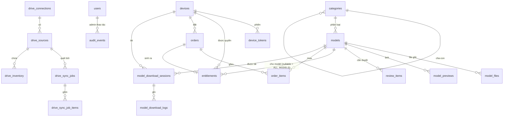

# 3DS Mood v3 — Database ERD + Migration Plan

> **D28 (2026-11-04) thay một phần tài liệu này:** license cả thư viện/1 máy (thay D18), bộ cài không đóng sẵn catalog/ảnh (thay D24/seed), OAuth Drive, R2, payOS, MXL1, đăng ký khách đã được gỡ khỏi code (xem `decisions.md` D26–D28). Phần mô tả các thứ đó chỉ còn là lịch sử thiết kế.

> Đi kèm [`v3-architecture.md`](v3-architecture.md). **Đề xuất, chưa chạy.** Nối tiếp migration hiện có `001–013`
> (nhánh `nam-lisence`). Mọi kiểu dữ liệu đã đối chiếu với schema hiện tại: `users.id uuid`, `sessions.id bytea`,
> `gen_random_uuid()` đang dùng sẵn.

## 1. Nguyên tắc

1. **Không lưu nhị phân** (ảnh, model) trong PostgreSQL — chỉ metadata và đường dẫn.
2. **Drive File ID chỉ nằm trong DB/backend**, không bao giờ vào response của API khách.
3. **Thêm trước, xóa sau:** migration v3 chỉ thêm bảng/cột. Bảng cũ (`catalog_*` 008–010, payOS 004/007, tài khoản khách)
   được xóa ở **đợt dọn riêng** sau khi luồng mới chạy ổn.
4. Mỗi migration có file `rollback/` tương ứng (như quy ước hiện có); rollback **từ chối** chạy nếu đã có dữ liệu thật
   ở bảng quyền/đơn (giống cách 003–007 đang làm).
5. Trạng thái dùng `text + check (...)` (đúng phong cách repo), không dùng enum type để dễ migration.

## 2. ERD

## 3. Bảng

> Ký hiệu: **PK**, **FK**, **UQ** (unique), **IX** (index). `users` (001, cột `role` từ 011) giữ nguyên, chỉ dùng cho **admin**.

### 3.1 Kết nối Drive (migration 014)

**drive_connections**
| Cột | Kiểu | Ràng buộc |
|---|---|---|
| id | uuid | PK default `gen_random_uuid()` |
| google_account_email | text | not null |
| auth_kind | text | `check in ('OAUTH_USER','SERVICE_ACCOUNT')` — để mở đường cho Q4 |
| encrypted_refresh_token | bytea | nullable (service account không cần) |
| token_iv | bytea | `octet_length = 12` khi có token |
| token_auth_tag | bytea | `octet_length = 16` khi có token |
| status | text | `check in ('CONNECTED','EXPIRED','RECONNECT_REQUIRED','DISABLED')` |
| connected_at, last_token_refresh_at | timestamptz | |
| last_error_code | text | `check ~ '^[A-Z][A-Z0-9_]{1,60}$'` — chỉ mã phân loại, không lưu message thô từ Google |
| created_by | uuid | FK → `users(id)` (admin) |

**drive_sources**
| Cột | Kiểu | Ràng buộc |
|---|---|---|
| id | uuid | PK |
| connection_id | uuid | FK → drive_connections, not null |
| root_folder_id | text | not null, `check ~ '^[A-Za-z0-9_-]{10,200}$'`, **UQ (connection_id, root_folder_id)** |
| root_folder_name | text | not null — tên hiển thị cho admin (thêm ở migration 014, thiếu trong bản thiết kế đầu) |
| root_resource_key | text | |
| source_type | text | `check in ('MY_DRIVE','SHARED_WITH_ME','SHARED_DRIVE')` |
| drive_id | text | khi là Shared Drive |
| enabled | boolean | default true |
| last_successful_sync_at | timestamptz | |
| change_page_token | text | để dành cho `changes.list` (giai đoạn sau) |

**oauth_states** (chống CSRF luồng OAuth)
| id (bytea sha256, PK) · admin_user_id (FK users) · code_verifier_ciphertext · expires_at (≤10 phút) · used_at |

### 3.2 Job và inventory (migration 015)

**drive_sync_jobs**
| Cột | Kiểu | Ràng buộc |
|---|---|---|
| id | uuid | PK |
| source_id | uuid | FK → drive_sources |
| mode | text | `check in ('FULL','INCREMENTAL')` |
| status | text | `check in ('QUEUED','RUNNING','CANCELLING','CANCELLED','COMPLETED','COMPLETED_WITH_ERRORS','FAILED')` |
| stage | text | `check in ('SCANNING','COMPARING','DOWNLOADING_PREVIEWS','PUBLISHING')` nullable |
| scanned_folders, scanned_files, new_count, updated_count, unchanged_count, missing_count, review_count, skipped_count, error_count | integer | default 0 |
| bytes_downloaded | bigint | default 0 |
| checkpoint | jsonb | `{stage,pageToken,folderQueue,lastItemId}` |
| lease_owner | text | id tiến trình worker |
| lease_expires_at, heartbeat_at | timestamptz | |
| cancel_requested | boolean | default false |
| attempt | integer | default 0 |
| requested_by | uuid | FK → users |
| created_at, started_at, finished_at | timestamptz | |
| error_code, error_message | text | message đã lọc, không có token |

Chỉ mục quan trọng:
* **UQ một phần:** `unique (source_id) where status in ('QUEUED','RUNNING','CANCELLING')` → chặn hai job cùng nguồn (kể cả hai admin bấm cùng lúc).
* **IX** `(status, lease_expires_at)` cho truy vấn nhận việc `FOR UPDATE SKIP LOCKED`.

**drive_sync_job_items**
| id uuid PK · job_id FK · drive_file_id text · action `check in ('SCAN','PREVIEW','PUBLISH','REVIEW')` · status `check in ('PENDING','DONE','FAILED','SKIPPED')` · retry_count int · error_code text · error_message text · **UQ (job_id, drive_file_id, action)** |

**drive_inventory** (ảnh chụp mới nhất của Drive, không phải catalog công bố)
| Cột | Kiểu | Ràng buộc |
|---|---|---|
| id | uuid | PK |
| source_id | uuid | FK |
| drive_file_id | text | **UQ (source_id, drive_file_id)** |
| parent_drive_id | text | IX |
| path | text | đường dẫn tương đối từ root, để mapper dùng |
| filename, mime_type | text | |
| is_folder, is_shortcut | boolean | |
| shortcut_target_id | text | |
| size_bytes | bigint | |
| modified_time | timestamptz | |
| md5_checksum | text | null với Google Docs |
| resource_key | text | |
| can_download | boolean | từ `capabilities.canDownload` |
| last_seen_job_id | uuid | FK → drive_sync_jobs; **chỉ có nghĩa khi job đã qua SCANNING** |

### 3.3 Catalog công bố (migration 016)

**categories**
| id uuid PK · parent_id uuid FK → categories (null = gốc) · name text · slug text · full_path text **UQ** · sort_order int · created_at, updated_at |

**models**
| Cột | Kiểu | Ràng buộc |
|---|---|---|
| id | uuid | PK — **Model ID công khai** |
| legacy_id | text | **UQ**, nullable — ID trong plugin đã phát hành (`036-bbq-bubble-spot`, `drive-…`) |
| category_id | uuid | FK → categories, not null |
| name | text | not null |
| status | text | `check in ('DRAFT','PUBLISHED','NEEDS_REVIEW','HIDDEN')` |
| price_vnd | integer | `check (price_vnd >= 0)`; model mới lấy `app_settings.default_model_price_vnd` |
| name_overridden, price_overridden | boolean | default false — admin đã sửa tay thì **đồng bộ Drive không ghi đè** |
| primary_file_id | uuid | FK → model_files (deferrable, vì tạo cùng transaction) |
| missing_scans | integer | default 0 — đếm số lượt quét hoàn tất không thấy file |
| created_at, updated_at, published_at | timestamptz | |

IX `(status, category_id)`; IX trigram trên `name` nếu cần tìm kiếm (để sau, cần extension `pg_trgm`).

**model_files**
| Cột | Kiểu | Ràng buộc |
|---|---|---|
| id | uuid | PK |
| model_id | uuid | FK → models |
| source_id | uuid | FK → drive_sources |
| drive_file_id | text | **UQ (source_id, drive_file_id)** — bản đồ nội bộ, **không lộ ra ngoài** |
| filename | text | |
| file_type | text | `check in ('zip','rar','7z','max','fbx','obj')` |
| size_bytes | bigint | |
| md5_checksum | text | từ Drive (đối chiếu đổi file) |
| sha256 | text | null tới khi tải lần đầu qua backend (Drive không cung cấp sha256) |
| entry_file | text | file `.max/.fbx/.obj` ưu tiên khi import (tùy chọn) |
| can_download | boolean | |
| download_status | text | `check in ('OK','RESTRICTED','MISSING','ERROR')` |

> **Ghi chú SHA-256:** plugin hiện kiểm SHA-256 của file tải (catalog cũ có sẵn sha256). Drive chỉ trả `md5Checksum`.
> Đề xuất: backend tính sha256 **trong lúc stream lần đầu** và lưu lại; manifest gửi `md5` + `size` để plugin kiểm,
> hoặc gửi sha256 nếu đã có. Cần chốt ở A1 (ảnh hưởng `ImportPipeline` của plugin).

**model_previews**
| Cột | Kiểu | Ràng buộc |
|---|---|---|
| id | uuid | PK |
| model_id | uuid | FK → models |
| source | text | `check in ('DRIVE_IMAGE','ARCHIVE_ENTRY')` (ARCHIVE_ENTRY để dành) |
| source_drive_file_id | text | nội bộ |
| source_md5 | text | để biết ảnh gốc đổi |
| local_path | text | đường dẫn tương đối trong thư mục preview, **UQ** |
| sha256 | text | của file WebP đã sinh |
| file_size, width, height | integer | |
| variant | text | `check in ('sm','lg')` |
| version | integer | tăng khi ảnh đổi |
| is_primary | boolean | **UQ một phần** `(model_id, variant) where is_primary` |

**review_items** (mapping mơ hồ, chờ admin)
| id uuid PK · source_id FK · kind `check in ('AMBIGUOUS_PAIR','ORPHAN_IMAGE','ORPHAN_MODEL','SUGGESTED_PAIR','REMAP_CANDIDATE','PREVIEW_IN_ARCHIVE')` · payload jsonb (chỉ đường dẫn/tên, không cần lộ ra khách) · status `check in ('OPEN','RESOLVED','DISMISSED')` · resolved_by FK users · resolved_at |

**catalog_state** (một dòng)
| id smallint PK `check (id = 1)` · active_version bigint · manifest_checksum text · published_at timestamptz · published_by_job uuid |

### 3.4 Thiết bị, quyền, đơn hàng (migration 017)

**devices**
| Cột | Kiểu | Ràng buộc |
|---|---|---|
| id | uuid | PK |
| device_uuid | uuid | **UQ** — UUID do `DeviceIdentityService` sinh |
| public_key | text | JWK RSA |
| public_key_hash | bytea | **UQ**, `octet_length = 32` |
| key_protection | text | `check in ('TPM','SOFTWARE')` (client tự báo, không attestation) |
| machine_code | text | `check (machine_code ~ '^MAX-[A-F0-9]{64}$')` — **nhãn**, không phải bằng chứng; IX |
| device_name | text | |
| status | text | `check in ('ACTIVE','BLOCKED')` |
| first_seen_at, last_seen_at | timestamptz | |

Không cho UPDATE `public_key`/`device_uuid` (trigger bất biến, giống `license_devices` ở 003).

**device_challenges** — tái dùng thiết kế 003 (id, device ref, nonce hash, purpose, expires_at ≤ 2 phút, used_at).
**device_tokens** — id (sha256 của token, PK) · device_id FK · expires_at (≤ 15 phút) · revoked_at.

**entitlements** (quyền dùng)
| Cột | Kiểu | Ràng buộc |
|---|---|---|
| id | uuid | PK |
| device_id | uuid | FK → devices, not null |
| scope | text | `check in ('MODEL','ALL_MODELS')` — **bán chỉ tạo `MODEL`** (D18); `ALL_MODELS` chỉ từ `MXL1`/`ADMIN` (thêm `check (scope='MODEL' or source in ('MXL1','ADMIN'))`) |
| model_id | uuid | FK → models; **`check ((scope='MODEL') = (model_id is not null))`** |
| source | text | `check in ('ORDER','ADMIN','MXL1')` |
| order_id | uuid | FK → orders, nullable |
| mxl1_license_id | text | id trong token MXL1 cũ, nullable, IX |
| granted_by | uuid | FK users (khi ADMIN) |
| granted_at | timestamptz | |
| revoked_at | timestamptz | nullable |

* **UQ một phần** `(device_id, model_id) where scope='MODEL' and revoked_at is null`.
* **UQ một phần** `(device_id) where scope='ALL_MODELS' and revoked_at is null`.

**orders**
| Cột | Kiểu | Ràng buộc |
|---|---|---|
| id | uuid | PK |
| code | text | **UQ**, ngắn để ghi nội dung chuyển khoản, ví dụ `3DM` + 6 ký tự |
| device_id | uuid | FK → devices |
| amount_vnd | integer | **tính ở server** từ `order_items` |
| status | text | `check in ('PENDING_PAYMENT','AWAITING_OWNER','CONFIRMED','REJECTED','EXPIRED','CANCELLED')` |
| telegram_chat_id | bigint | chat của chủ đã nhận tin |
| telegram_message_id | bigint | để sửa tin sau khi quyết định |
| claimed_paid_at, decided_at, expires_at | timestamptz | |
| decided_by_telegram_user | bigint | ai bấm |
| created_at | timestamptz | |

* IX `(device_id, status)` — dùng cho giới hạn số đơn chờ mỗi thiết bị.
* Chuyển trạng thái chỉ qua `UPDATE … WHERE status = <trạng thái mong đợi>` trong transaction → bấm nút hai lần chỉ một lần thắng.

**order_items** — id · order_id FK · model_id FK **not null** · price_vnd (giá chụp lúc tạo đơn) · **UQ (order_id, model_id)**.

Thêm vào **orders**: `bank_snapshot jsonb not null` — tên ngân hàng, số TK, chủ TK, nội dung chuyển khoản **tại thời điểm tạo đơn** (đổi cài đặt sau đó không làm sai đơn cũ).

**app_settings** (một dòng, sửa ở trang admin — D25)
| Cột | Kiểu | Ràng buộc |
|---|---|---|
| id | smallint | PK `check (id = 1)` |
| bank_name, bank_bin, account_no, account_name | text | nullable — **chưa có thì API tạo đơn trả `PAYMENT_NOT_CONFIGURED`** |
| default_model_price_vnd | integer | `check (>= 0)` — giá cho model mới đồng bộ từ Drive |
| order_ttl_minutes | integer | default 1440 |
| max_pending_orders_per_device | integer | default 3 |
| updated_by | uuid | FK users |
| updated_at | timestamptz | |

### 3.5 Tải model và audit (migration 018)

**model_download_sessions**
| id uuid PK (giá trị trả cho plugin là token ngẫu nhiên; DB lưu **hash**) · token_hash bytea UQ · model_id FK · device_id FK · entitlement_id FK · status `check in ('CREATED','STREAMING','COMPLETED','FAILED','EXPIRED')` · expires_at (≤ 5 phút để bắt đầu) · started_at · finished_at |

**model_download_logs** — id · session_id FK · model_id · device_id · bytes_sent bigint · status · error_code · created_at. IX `(device_id, created_at)` cho rate limit theo thiết bị.

**audit_events** — dùng bảng audit hiện có của module admin nếu đã có cùng mục đích; nếu không, tạo: id · actor_kind (`ADMIN|TELEGRAM_OWNER|SYSTEM`) · actor_ref · action · target_type · target_id · details jsonb (đã lọc) · created_at. Bảng audit hiện có `license_audit_logs` gắn với `license_id` của hệ license theo tài khoản (003), không dùng chung được cho thiết bị/đơn/Drive → **tạo `audit_events` mới**; giữ bảng cũ tới đợt dọn P7.

## 4. Ranh giới transaction

| Thao tác | Trong một transaction |
|---|---|
| Publish catalog | upsert categories, models, model_files, model_previews; `catalog_state.active_version += 1`; đóng job |
| Xác nhận đơn (Telegram) | `orders` AWAITING_OWNER→CONFIRMED (điều kiện trạng thái) + insert `entitlements` + audit |
| Tạo phiên tải | kiểm thiết bị + entitlement + model `PUBLISHED` + `can_download` → insert session |
| Nhận job | `SELECT … FOR UPDATE SKIP LOCKED` + set lease (một câu `UPDATE … RETURNING`) |
| Lưu refresh token | upsert `drive_connections` + audit |

## 5. Kế hoạch migration

| Số | Nội dung | Rủi ro | Rollback |
|---|---|---|---|
| 014 | `drive_connections`, `drive_sources`, `oauth_states` | Thấp (bảng mới) | drop nếu rỗng |
| 015 | `drive_sync_jobs`, `drive_sync_job_items`, `drive_inventory` | Thấp | drop |
| 016 | `categories`, `models`, `model_files`, `model_previews`, `review_items`, `catalog_state` | Thấp | drop nếu chưa có model `PUBLISHED` từ Drive |
| 017 | `devices`, `device_challenges`(mới), `device_tokens`, `entitlements`, `orders`, `order_items`, `app_settings` | **Trung bình** — bảng tiền/quyền | **từ chối** nếu có đơn `CONFIRMED` hoặc entitlement |
| 018 | `model_download_sessions`, `model_download_logs`, (`audit_events` nếu thiếu) | Thấp | drop |
| seed | Nạp 360 mục từ `library/public/catalog.json`: tạo categories theo `"Parent / Child"`, models với `legacy_id`, model_files với `drive_file_id` + sha256 | Thấp | xóa theo `legacy_id` |
| (đợt dọn, sau khi ổn định) | Drop `catalog_*` (008–010), bảng payOS (004, 007), bảng license theo tài khoản (003, 005, 006) **sau khi xác nhận không còn dữ liệu cần giữ** | Cao | Backup trước; chỉ chạy khi chủ dự án duyệt |

**Kiểm thử migration:** chạy 001→018 trên DB trống; chạy 014→018 trên bản sao DB dev có dữ liệu 001–013; chạy rollback 018→014; chạy lại 014→018 (idempotent qua `schema_migrations` như hiện có).
